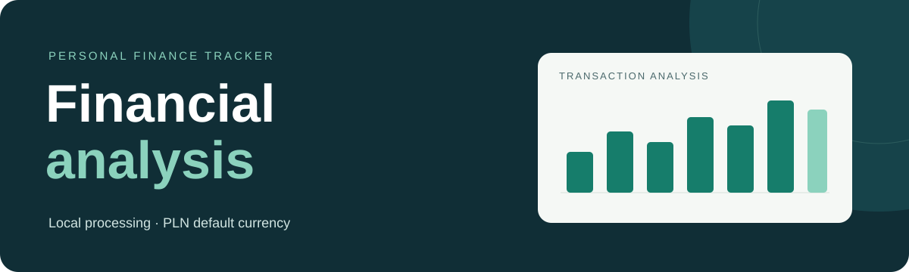

<p align="center">
  
</p>

<h1 align="center">Personal Finance Tracker</h1>
<p align="center">Local analysis of bank exports, transaction categories and cash flow.</p>
<p align="center"><strong>Local data processing</strong> &nbsp;·&nbsp; <strong>PLN default currency</strong> &nbsp;·&nbsp; <strong>Configurable imports</strong> &nbsp;·&nbsp; <strong>AI-assisted setup</strong></p>

---

Personal Finance Tracker is a local application for analyzing bank export data. It provides spending and income summaries, cash-flow trends, category and merchant breakdowns, and a searchable transaction ledger.

The repository includes application source, documentation, configuration examples and a synthetic demo generator. Personal exports, processed transactions and classification rules are stored in local directories excluded from version control. The application does not upload bank records or require an AI service.

## AI-assisted setup

On Windows, clone the repository **inside WSL**, then open the project directory in Claude Code or Codex:

```bash
git clone https://github.com/Komptip/personal-finance-tracker.git
cd personal-finance-tracker
```

Suggested setup request:

> Read AGENTS.md and docs/SETUP.md. Set up the repository locally, preserve any existing dataset, run the validation checks, and start the application. Then configure my bank export mapping according to docs/IMPORTING.md. Keep exports and personal classification rules out of Git. Obtain my authorization before replacing an existing dataset.

[`AGENTS.md`](AGENTS.md) defines the shared agent instructions. [`CLAUDE.md`](CLAUDE.md) directs Claude to those instructions. The application does not require an API key.

## Manual setup

Requirements: **Node.js 22+**, **npm**, **Python 3.10+** and **Git**. On Windows, run the following commands in WSL Ubuntu from the cloned repository.

```bash
nvm install                 # optional: select Node using .nvmrc if nvm is installed
nvm use
npm run setup               # install dependencies; create demo data if no dataset exists
npm run dev
```

The application is available at **[localhost:3000](http://localhost:3000)**. Repeated setup runs preserve existing datasets. A new installation generates 42 synthetic PLN transactions, identified as demo data in the interface.

## Features

| Component            | Function                                                                                            |
| -------------------- | --------------------------------------------------------------------------------------------------- |
| **Overview**         | Spending, income and net-flow summaries; time-series charts; category rankings; recent transactions |
| **Transactions**     | Search by merchant or description, filter by date and tag, and inspect original transaction details |
| **Review**           | Inspect observations, supporting transactions, and uncertain or uncategorized labels                |
| **Currency display** | PLN by default, with EUR, USD and UAH display conversion using dated NBP average rates              |

Transactions tagged as transfers between the user's own accounts are excluded from totals by default. Classification rules produce inferred labels that require review. The application does not provide bank synchronization or accounting functionality.

## Data import

1. Store CSV exports in `private/imports/`.
2. Copy the example mapping and classification rules into `private/` and configure them for the export headers.
3. Import the complete set of exports for the dataset:

```bash
mkdir -p private/imports
cp config/import.example.json private/import.json
cp config/rules.example.json private/rules.json

python3 -m pipeline import \
  --input private/imports \
  --mapping private/import.json \
  --rules private/rules.json \
  --replace
```

`--replace` replaces the active dataset, including demo data. Source exports are preserved. Reload the browser after importing. The [data import guide](docs/IMPORTING.md) documents candidate validation, decimal separators, debit and credit columns, duplicate IDs, custom classification rules and the experimental Polish PDF adapter.

## Data pipeline

```text
private/imports/       →  Python validation and classification
                                   ↓
data/processed/        →  tagged_transactions.csv
                                   ↓
local Nuxt API         →  Overview · Transactions · Review
```

Imports are validated before the processed dataset is replaced. The local API reads the processed file and supplies transaction data to the interface. Display conversion retrieves a public NBP exchange-rate table without sending transaction data; original amounts and currencies are preserved.

## Technology stack

| Component                     | Technology                  |
| ----------------------------- | --------------------------- |
| Interface and local API       | Nuxt 3 · Vue 3 · TypeScript |
| Charts                        | Chart.js · vue-chartjs      |
| CSV import and classification | Python standard library     |
| Optional PDF extraction       | pdfplumber                  |

## Development and validation

```bash
npm run check              # formatting, type checks, Python and TypeScript tests
npm run build              # production build
npm run privacy:history    # inspect tracked files and reachable commit history
```

## Privacy and deployment

The development and preview servers bind to `127.0.0.1`. The application has no authentication and is intended for local use. Do not publish a deployment containing personal data or expose the application through a public tunnel.

Git exclusions reduce the risk of accidental publication but do not encrypt local files. Maintain local backups and review staged files and commit history before publication. See [privacy and contribution requirements](docs/PRIVACY.md) for details.

## Documentation

- **[Installation and configuration](docs/SETUP.md)** — prerequisites, WSL setup, startup, currency display and troubleshooting.
- **[Data import](docs/IMPORTING.md)** — supported formats, field mapping, validation and classification rules.
- **[Privacy and contributions](docs/PRIVACY.md)** — data exclusions, Git checks and publication requirements.
- **[Agent instructions](AGENTS.md)** — setup and import procedures with verification requirements.
